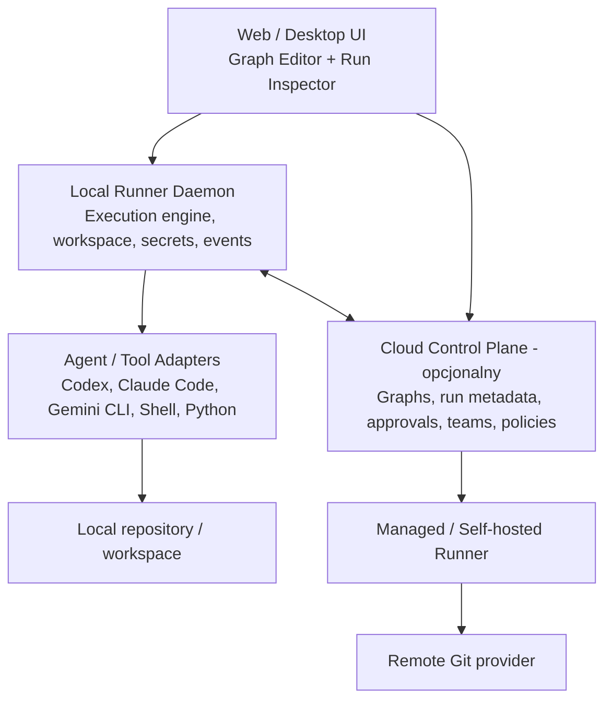
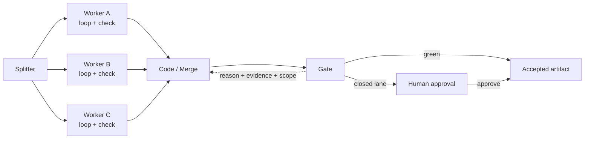

# Agent Execution Control Plane

## Architektura produktu, plan MVP i wykorzystanie w pracy licencjackiej

**Wersja:** 0.1  
**Data:** 11 września 2026  
**Status:** dokument koncepcyjny / architektoniczny

---

## 1. Streszczenie

Celem projektu jest stworzenie **local-first IDE oraz control plane do wykonywania, obserwowania i debugowania systemów agentowych AI**. Produkt nie ma być kolejnym frameworkiem do budowania agentów. Ma stanowić warstwę wykonawczą i kontrolną dla agentów, narzędzi i modeli, których użytkownik już używa lokalnie lub w chmurze.

Główna idea architektoniczna opiera się na rozdzieleniu dwóch poziomów:

- **graph** opisuje kształt pracy: jakie jednostki istnieją, które mogą działać równolegle, jakie są zależności, gdzie następuje merge i gdzie wymagany jest gate;
- **loop** działa wewnątrz pojedynczego node'a i odpowiada za lokalną korektę: `produce -> check -> correct -> repeat until green`.

Produkt powinien umożliwiać uruchamianie graphów na laptopie użytkownika, na własnym runnerze lub - w późniejszym etapie - w zarządzanym środowisku chmurowym. Wersja bezpłatna może być kompletna dla lokalnego zastosowania, natomiast płatny cloud powinien monetyzować przede wszystkim zdalne sterowanie, współpracę, historię, polityki, harmonogramy, audyt i managed runners.

Projekt dobrze wpisuje się w temat pracy licencjackiej **„Wdrażanie systemów agentowych AI do środowisk produkcyjnych”**, ponieważ pozwala zbadać problemy niezawodności, obserwowalności, retry, izolacji, kontroli kosztów, human-in-the-loop i reprodukowalności wykonania.

---

## 2. Wizja produktu

### 2.1. Problem

Współczesne coding agents i narzędzia agentowe dobrze wykonują pojedyncze zadania, ale wraz ze wzrostem autonomii pojawiają się problemy systemowe:

- nie wiadomo, co dokładnie agent wykonuje w danym momencie;
- retry często obejmuje zbyt szeroki zakres;
- niezależne zadania są niepotrzebnie wykonywane sekwencyjnie;
- walidacja bywa oparta na subiektywnej ocenie kolejnego modelu;
- trudno odtworzyć, dlaczego dany wynik został zaakceptowany;
- człowiek staje się ręcznym schedulerem i reviewerem każdego kroku;
- logi z kilku terminali nie tworzą czytelnego modelu przebiegu pracy;
- lokalne wykonania nie mają spójnej historii i warstwy kontroli;
- wdrożenie do środowiska zespołowego wymaga osobno rozwiązania uprawnień, audytu, sekretów, izolacji i kosztów.

### 2.2. Proponowane pozycjonowanie

Najtrafniejsze określenia produktu:

> **Debug and control plane for local AI agents** / **The execution layer for coding agents**

Opis funkcjonalny:

> Narzędzie do projektowania graphów agentowych, uruchamiania ich lokalnie lub w chmurze, obserwowania każdego kroku, kontrolowania retry i gate'ów oraz analizowania pełnego trace'u wykonania.

### 2.3. Czego produkt nie powinien próbować zastąpić

W pierwszej wersji projekt nie powinien być:

- nowym foundation model providerem;
- frameworkiem wymagającym przepisywania istniejących agentów;
- pełnym zamiennikiem CI/CD;
- kolejnym n8n, w którym każdy node jest LLM-em;
- platformą do trenowania modeli;
- pełnym systemem zarządzania projektami.

Agent, shell command, skrypt lub istniejące CLI powinny być podłączane przez cienkie adaptery.

---

## 3. Zasady projektowe

### 3.1. Local-first

Kod użytkownika domyślnie pozostaje lokalnie. Cloud jest opcjonalną warstwą sterowania i współpracy.

### 3.2. Graph jest kontraktem wykonania

Graf powinien być serializowalny do pliku tekstowego i wersjonowany w Git. UI jest wygodnym edytorem reprezentacji, nie jedynym źródłem prawdy.

### 3.3. Node nie oznacza agenta

System powinien posiadać kilka typów node'ów. Model językowy jest tylko jednym z nich.

### 3.4. Edge oznacza zależność danych

Połączenie powinno istnieć wtedy, gdy downstream node rzeczywiście konsumuje output poprzedniego node'a. Sama kolejność „a potem” nie jest wystarczającym powodem do utworzenia edge'a.

### 3.5. Deterministyczna walidacja przed oceną modelu

Jeżeli poprawność można określić testem, exit code'em, schematem, typami lub inną programowalną regułą, taka walidacja powinna być preferowana przed subiektywną oceną LLM.

### 3.6. Retry dotyczy najmniejszej błędnej jednostki

Nie należy zwracać całego batcha do ponownego wykonania, gdy zawiódł tylko jeden unit.

### 3.7. Human-in-the-loop na podstawie blast radius

Decyzja o zatrzymaniu przebiegu dla człowieka powinna wynikać przede wszystkim z konsekwencji błędu i odwracalności zmiany, nie z deklarowanej przez model pewności.

### 3.8. Pełny trace jest częścią produktu

Run bez danych o inputach, outputach, próbach, checkach, verdictach i wersjach graphu nie powinien być traktowany jako poprawnie obserwowalne wykonanie.

---

## 4. Architektura wysokiego poziomu



System składa się z pięciu głównych warstw:

1. **UI / IDE** - edytor graphów, konfiguracja node'ów, live execution map, Run Inspector.
2. **Execution Engine** - scheduler DAG, retry, fan-out/fan-in, stan wykonania, gate'y.
3. **Local Runner** - daemon uruchamiany na urządzeniu użytkownika, mający dostęp do repozytoriów, procesów i lokalnych narzędzi.
4. **Adapters** - integracje z coding agents, CLI, shell, Pythonem, narzędziami i ewentualnie API modeli.
5. **Cloud Control Plane** - opcjonalny backend dla zdalnego uruchamiania, współpracy, historii, polityk, zespołów, schedulerów i managed runners.

### 4.1. Tryby wykonania

System powinien docelowo obsługiwać trzy równorzędne execution targets:

| Tryb | Gdzie działa kod | Główne zastosowanie |
|---|---|---|
| Local | laptop/developer workstation | development, prywatne repo, szybki debug |
| Self-hosted runner | serwer użytkownika | zespoły, wewnętrzna infrastruktura, większa ciągłość |
| Managed cloud | ephemeral runner dostawcy | skalowanie, scheduled runs, brak zależności od laptopa |

---

## 5. Model wykonania: graph, node, edge, loop i gate



### 5.1. Graph

Graph opisuje całość procesu i odpowiada na pytania:

- jakie jednostki pracy istnieją;
- które mogą zostać uruchomione równolegle;
- które zależą od danych wyprodukowanych wcześniej;
- gdzie następuje fan-out i fan-in;
- co jest warunkiem zakończenia;
- gdzie wynik może wrócić do wcześniejszego kroku;
- w którym miejscu człowiek musi zatwierdzić zmianę.

### 5.2. Typy node'ów

Minimalny zestaw dla MVP:

| Typ | Odpowiedzialność |
|---|---|
| Agent | wykonanie zadania przez coding agent / model |
| Shell | deterministyczny command lub skrypt |
| Gate | walidacja i decyzja o przejściu dalej |
| Human | ręczna decyzja dla pracy o wysokim blast radius |

Typy rekomendowane w kolejnych wersjach:

- Splitter;
- Code;
- Merge;
- Router;
- Artifact transform;
- Subgraph;
- External trigger.

### 5.3. Kontrakt node'a

Każdy node powinien mieć jawny kontrakt wejścia i wyjścia:

```text
NodeInput  -> execute() -> NodeOutput
```

Przykładowy kontrakt:

```json
{
  "input": {
    "task": "string",
    "workspace": "path",
    "constraints": ["string"]
  },
  "output": {
    "summary": "string",
    "changed_files": ["path"],
    "artifacts": ["artifact_ref"]
  }
}
```

### 5.4. Edge jako jawny przepływ danych

Edge powinien opisywać, co konkretnie jest przekazywane:

```text
planner.output.backend_units
            |
            v
backend_worker.input.units
```

Dzięki temu system może wykrywać potencjalnie zbędne zależności. Jeżeli node B nie odwołuje się do żadnego outputu A, UI może zasugerować możliwość równoległego wykonania.

### 5.5. Loop wewnątrz node'a

Loop to lokalny mechanizm poprawy pojedynczego unit'u:

```text
produce
  |
  v
check --green--> done
  |
 red
  v
correct
  |
  +-------------> produce
```

Loop powinien mieć:

- jednoznaczny check;
- limit prób;
- zachowany evidence z każdej próby;
- ograniczony scope korekty;
- politykę eskalacji po wyczerpaniu prób.

Domyślnie rozsądny limit to 3 próby. Po przekroczeniu limitu błąd może wskazywać nie na problem implementacji, lecz na problem planu, kontekstu lub samego kryterium.

### 5.6. Return envelope

Przy zwrocie jednostki do poprawy powinny podróżować co najmniej:

```json
{
  "unit": "handlers",
  "verdict": "red",
  "reason": "test_auth_redirect failed",
  "evidence": "expected 302, got 200; handlers/auth.py:88",
  "scope": ["handlers/auth.py"],
  "attempt": 2
}
```

Kluczowy jest `scope`: korekta nie powinna niekontrolowanie rozszerzać diffu.

### 5.7. Gate

Gate jest punktem kontrolnym, którego verdict wpływa na dalsze wykonanie. Gate może bazować na:

1. deterministycznych wynikach;
2. trajektorii bieżącego runa;
3. historycznej jakości danego node'a;
4. polityce blast radius;
5. ocenie modelu - dopiero jako słabszym sygnale.

Przykłady checków:

```text
GREEN: test suite exits 0
GREEN: changed_files is subset of planned_files
GREEN: every claim has a source reference
GREEN: schema validation passes
```

Przykłady słabych checków:

```text
"looks good"
"model is confident"
"no exception occurred"
```

---

## 6. Model stanów wykonania

Każdy run graphu posiada globalny stan, a każdy node własny lifecycle.

### 6.1. Stan node'a

Proponowany state machine:

```text
PENDING
  -> READY
  -> RUNNING
  -> CHECKING
      -> SUCCEEDED
      -> CORRECTING -> RUNNING
      -> WAITING_FOR_HUMAN
      -> FAILED
      -> CANCELED
```

### 6.2. Stan graph runa

```text
QUEUED
RUNNING
WAITING_FOR_HUMAN
SUCCEEDED
FAILED
CANCELED
INTERRUPTED
```

`INTERRUPTED` jest ważny dla produkcyjności: run powinien mieć możliwość wznowienia po restarcie runnera lub aplikacji, zamiast zaczynać od zera.

### 6.3. Event sourcing / append-only execution log

Execution Engine powinien generować zdarzenia zamiast wyłącznie nadpisywać aktualny stan:

```text
RunStarted
NodeReady
NodeStarted
AgentOutputChunk
ArtifactCreated
CheckStarted
CheckFailed
CorrectionRequested
NodeSucceeded
HumanApprovalRequested
HumanApproved
RunSucceeded
```

Aktualny stan może być projekcją z event logu. Daje to:

- replay;
- debugowanie;
- pełny audyt;
- synchronizację local <-> cloud;
- łatwiejszą telemetrię;
- możliwość odtworzenia UI z historii zdarzeń.

---

## 7. Local Runner

Local Runner jest krytycznym elementem architektury. Powinien działać jako lekki daemon oraz mieć CLI.

### 7.1. Odpowiedzialności

- rejestracja dostępnych workspace'ów;
- uruchamianie agentów i procesów;
- kontrola cwd, env i sekretów;
- lifecycle procesów;
- limity timeout, CPU/memory w miarę możliwości;
- streaming stdout/stderr i eventów;
- zarządzanie artifactami;
- wykonywanie checków;
- utrzymywanie stanu runa;
- opcjonalna komunikacja z Cloud Control Plane.

### 7.2. Proponowane interfejsy

CLI:

```bash
agentctl run fix-issue --input issue=123
agentctl graph validate .agents/graphs/fix-issue.yaml
agentctl runs inspect run_01H...
agentctl runner status
```

Lokalne API:

```text
HTTP:     127.0.0.1:<port>
WebSocket: live events
```

### 7.3. Połączenie z chmurą

Runner powinien inicjować **outbound connection** do backendu. Użytkownik nie powinien otwierać publicznego portu na laptopie.

Cloud wysyła logiczne polecenie:

```text
execute graph X on registered workspace Y
```

Runner lokalnie rozwiązuje ścieżkę repozytorium, sekrety i wykonanie.

---

## 8. Adaptery agentów i narzędzi

Celem jest uniknięcie lock-inu do jednego frameworka lub providera.

### 8.1. Minimalny interfejs

```ts
interface ExecutionAdapter {
  id(): string;
  detect(): Promise<CapabilityReport>;
  execute(input: ExecutionInput, ctx: RunContext): AsyncIterable<ExecutionEvent>;
  cancel(executionId: string): Promise<void>;
}
```

### 8.2. Pierwsze adaptery

MVP:

- ShellAdapter;
- generic ProcessAdapter;
- jeden coding-agent adapter, który twórca projektu faktycznie używa najczęściej;
- opcjonalnie drugi adapter w celu sprawdzenia neutralności architektury.

Kolejne:

- Codex CLI;
- Claude Code;
- Gemini CLI;
- Python;
- HTTP/MCP;
- Docker job;
- custom executable.

### 8.3. Capability detection

Runner po instalacji może raportować:

```text
Git          available
Docker       available
Codex        available
Claude Code  available
Python       3.x
Node         22.x
```

Graph może deklarować wymagania, a system sprawdzać je przed uruchomieniem.

---

## 9. Repozytorium i workspace

### 9.1. Tryb lokalny

Repo pozostaje na komputerze użytkownika. Runner otrzymuje logiczny identyfikator workspace, niekoniecznie przesyła jego ścieżkę do chmury.

### 9.2. Tryb managed cloud

Przyszły model:

```text
Git provider
   -> ephemeral worker
   -> clone repository
   -> checkout isolated branch/worktree
   -> execute graph
   -> push branch / create PR
   -> destroy worker
```

### 9.3. Izolacja

Docelowe poziomy izolacji:

1. osobny git worktree;
2. osobny proces z ograniczonym env;
3. kontener;
4. ephemeral VM / sandbox dla cloud runners.

MVP może rozpocząć od worktree + procesów, ale architektura nie powinna zakładać, że proces agenta jest zaufany.

---

## 10. Bezpieczeństwo i model zaufania

System agentowy może wykonywać kod, modyfikować pliki i korzystać z sekretów. Bezpieczeństwo jest częścią architektury, nie dodatkiem.

### 10.1. Podstawowe zasady

- secrets pozostają po stronie execution environment;
- cloud nie otrzymuje sekretów local runnera;
- każdy node deklaruje wymagane capabilities;
- domyślna zasada minimalnych uprawnień;
- możliwość read-only workspace;
- możliwość blokady komend lub ścieżek;
- każdy human approval zapisuje kto/co/kiedy zaakceptował;
- artefakty i logi mogą mieć politykę retencji;
- nie wysyłać kodu do cloud control plane bez jawnej konfiguracji.

### 10.2. Blast radius policy

Przykładowe klasy:

| Klasa | Przykłady | Polityka |
|---|---|---|
| L1 - contained/reversible | test, copy, izolowana funkcja | auto-open po checkach |
| L2 - wide/reversible | shared utility, public API | dodatkowy gate / trajectory |
| L3 - hard to reverse | migracja DB, delete, prod write, money | human gate zawsze zamknięty |

### 10.3. Policy engine - późniejszy etap

Przykładowe reguły:

```yaml
policies:
  - when: diff.matches("migrations/**")
    require: human_approval

  - when: command.matches("terraform apply")
    deny: true

  - when: changed_files.count > 20
    require: human_approval
```

---

## 11. Graph Definition Format

Graph powinien istnieć jako plik w repozytorium, np. `.agents/graphs/fix-issue.yaml`.

Przykład:

```yaml
version: 1
name: fix-issue

inputs:
  issue:
    type: string

nodes:
  plan:
    type: agent
    adapter: codex
    prompt: |
      Analyze issue {{ inputs.issue }}.
      Split work into independent units.

  backend:
    type: agent
    adapter: claude-code
    foreach: "{{ nodes.plan.output.backend_units }}"
    depends_on: [plan]
    loop:
      max_attempts: 3
      check:
        type: shell
        run: pytest tests/backend

  frontend:
    type: agent
    adapter: codex
    foreach: "{{ nodes.plan.output.frontend_units }}"
    depends_on: [plan]
    loop:
      max_attempts: 3
      check:
        type: shell
        run: npm test

  merge:
    type: shell
    depends_on: [backend, frontend]
    run: ./scripts/verify-diff.sh

  approve:
    type: human
    depends_on: [merge]
    when: "{{ blast_radius >= 3 }}"
```

### 11.1. Wymagania formatu

- deterministyczny parser;
- schema validation;
- jednoznaczne dependency references;
- jawne versioning;
- możliwość diffowania w Git;
- brak sekretów w graph file;
- łatwa migracja schematu w przyszłości.

---

## 12. Run Inspector - kluczowy ekran produktu

Run Inspector powinien być ważniejszy niż sam edytor graphu. Jego zadaniem jest odpowiedzenie na pytanie: **co wydarzyło się podczas wykonania i dlaczego?**

### 12.1. Widok całości

Przykład:

```text
RUN #184

Split task                 1.2s    OK
|- backend                44.8s    OK
|  |- attempt 1                    RED
|  |  test_auth_redirect failed
|  `- attempt 2                    GREEN
|
|- frontend               31.2s    OK
`- migration               8.4s    WAITING FOR HUMAN

Wall clock:        48.3s
Agent time:        85.6s
Parallelism saved: 37.3s
Model calls:       7
Retries:           1
```

### 12.2. Widok node'a

Powinien pokazywać:

- input;
- resolved prompt/command;
- adapter i wersję;
- stream wydarzeń;
- output;
- artifacty;
- changed files / diff metadata;
- check command;
- verdict;
- evidence;
- retry history;
- scope kolejnej korekty;
- duration;
- token/usage metadata, jeśli adapter je udostępnia.

### 12.3. Debug operations

Przydatne akcje:

- replay node;
- rerun from node;
- rerun failed units only;
- clone run with changed input;
- compare two attempts;
- compare two graph versions;
- export run to JSON.

---

## 13. Dane i podstawowy model domenowy

Minimalne encje:

```text
GraphDefinition
GraphVersion
NodeDefinition
EdgeDefinition
Run
NodeRun
Attempt
Artifact
CheckResult
Approval
Constraint
Runner
Workspace
ExecutionEvent
```

### 13.1. Relacje

```text
GraphDefinition 1 --- N GraphVersion
GraphVersion    1 --- N Run
Run             1 --- N NodeRun
NodeRun         1 --- N Attempt
Attempt         1 --- N Artifact
Attempt         1 --- N CheckResult
Run             1 --- N ExecutionEvent
```

### 13.2. Lokalny storage

Dla MVP:

- SQLite dla metadanych;
- filesystem dla dużych artifactów/logów;
- YAML/JSON dla graph definitions;
- Git dla versioningu graphów.

To jest wystarczające do local-first prototypu i upraszcza development.

---

## 14. Cloud Control Plane

Cloud powinien monetyzować problemy, których lokalny developer nie chce sam rozwiązywać.

### 14.1. Funkcje Pro

- konto i synchronizacja graph metadata;
- remote access do runów;
- zdalne startowanie local runnera;
- long-term history;
- harmonogramy;
- alerty;
- mobile/web approvals;
- dashboards i cost analytics;
- backup metadata;
- managed artifact storage opcjonalnie.

### 14.2. Funkcje Team/Business

- shared graphs;
- shared constraints;
- organizacje i projekty;
- RBAC;
- audit log;
- policy engine;
- shared runners;
- centralized secrets references;
- Git provider integrations;
- budget controls;
- SSO/SAML w dalszej przyszłości.

### 14.3. Managed runners

Managed compute powinien być osobną warstwą od control plane. Dzięki temu można najpierw zbudować wartość SaaS bez ponoszenia kosztu i złożoności uruchamiania nieufnego kodu klientów.

---

## 15. Potencjalny model produktu i cen

Poniższe wartości są wyłącznie hipotezą produktową.

| Funkcja | Local Free | Pro | Team |
|---|---:|---:|---:|
| Visual graph editor | tak | tak | tak |
| Local runner | tak | tak | tak |
| Loops / gates | tak | tak | tak |
| Local history | tak | tak | tak |
| Cloud history | - | tak | tak |
| Remote runs | - | tak | tak |
| Scheduling | - | tak | tak |
| Shared graphs | - | - | tak |
| RBAC | - | - | tak |
| Audit / policies | - | - | tak |
| Managed runner | - | usage | usage |

Hipoteza cenowa do walidacji:

- Local: free;
- Pro: około 15-25 EUR/USD miesięcznie;
- Team: około 30-50 EUR/USD za użytkownika miesięcznie;
- managed compute: osobno według usage.

Najważniejsza zasada: darmowa wersja lokalna powinna być realnie użyteczna. Upgrade powinien wynikać z potrzeby ciągłości, zdalności i pracy zespołowej, a nie sztucznego limitu liczby node'ów.

---

## 16. Sugerowany stack techniczny

Stack nie powinien być traktowany jako część domeny; można go zmienić bez zmiany modelu wykonania.

### 16.1. UI

- React + TypeScript;
- React Flow / podobna biblioteka do edytora DAG;
- Monaco Editor dla YAML/JSON i promptów;
- WebSocket/SSE dla live events.

### 16.2. Desktop

Opcje:

- Tauri - cienka powłoka i współdzielenie webowego UI;
- Electron - szybszy start kosztem większego footprintu.

Rekomendacja dla docelowego produktu: **Tauri**, jeśli czas implementacji nie stanie się przeszkodą dla licencjatu.

### 16.3. Runner / execution engine

Dwie pragmatyczne opcje:

**Go**
- proste dystrybuowanie single binary;
- dobry model współbieżności;
- wygodna obsługa procesów i networking.

**Rust**
- większa kontrola i bezpieczeństwo pamięci;
- dobre dopasowanie do Tauri;
- wyższy koszt implementacyjny.

Dla pracy licencjackiej i MVP Go może przyspieszyć development. Jeżeli twórca ma już silne doświadczenie w Rust, Rust również jest dobrym wyborem.

### 16.4. Cloud backend

Na początku wystarczy prosty monolit:

- TypeScript/Node albo Go;
- Postgres;
- object storage dla artifactów;
- WebSocket gateway / durable connection registry;
- prosty job scheduler.

Nie ma potrzeby zaczynać od mikroserwisów.

---

## 17. MVP - zakres rekomendowany

### 17.1. Must-have

1. Graph definition w YAML/JSON.
2. Visual graph editor.
3. Cztery node types: Agent, Shell, Gate, Human.
4. DAG scheduler.
5. Równoległe wykonanie niezależnych node'ów.
6. Local runner.
7. Minimum jeden prawdziwy coding-agent adapter.
8. Loop z max attempts.
9. Lokalny retry tylko błędnej jednostki.
10. Run Inspector.
11. Event log.
12. Resume/recovery w podstawowej formie.
13. Export run -> JSON.
14. Basic metrics: duration, attempts, status, command/test result.

### 17.2. Should-have

- git worktrees;
- compare attempts;
- graph validation;
- capability detection;
- changed-files scope check;
- token/cost metadata, jeżeli dostępne;
- reusable graph templates.

### 17.3. Poza MVP

- managed cloud compute;
- zaawansowany RBAC;
- enterprise SSO;
- marketplace graphów;
- pełny policy language;
- rozbudowana „agent memory”;
- automatyczne uczenie promptów;
- Kubernetes-native orchestration.

---

## 18. Plan realizacji

Poniższa roadmapa zakłada iteracyjne dowożenie pionowych fragmentów produktu.

### Faza 0 - specyfikacja i prototyp domeny

**Cel:** potwierdzić model graph/node/run bez UI.

- Graph schema v0;
- parser i validator;
- in-memory DAG scheduler;
- Shell node;
- event model;
- CLI do uruchamiania graphu.

**Kryterium ukończenia:** graph z trzema shell node'ami potrafi wykonać dwie niezależne gałęzie równolegle i złączyć wyniki.

### Faza 1 - agent execution + loop

- adapter jednego coding agenta;
- streaming output;
- Gate node;
- check result;
- correction loop;
- max attempts;
- failed-unit retry.

**Kryterium ukończenia:** agent potrafi zmienić repo, uruchomić test, otrzymać konkretny reason/evidence i poprawić tylko swój unit.

### Faza 2 - Local IDE

- graph editor;
- konfiguracja node'ów;
- live execution map;
- podstawowy Run Inspector;
- lista historii runów;
- SQLite.

**Kryterium ukończenia:** cały typowy workflow można zaprojektować i debugować bez korzystania z terminala poza startem aplikacji.

### Faza 3 - produkcyjność lokalna

- worktrees / izolacja workspace;
- resume po restarcie;
- cancel;
- timeouts;
- artifact handling;
- export JSON/CSV;
- wersjonowanie graphu.

### Faza 4 - Cloud Control Plane alpha

- account/project;
- rejestracja runnera;
- outbound secure connection;
- remote run start;
- cloud run metadata;
- web approval.

### Faza 5 - płatny produkt

- scheduling;
- long-term history;
- team workspaces;
- RBAC;
- audit;
- billing;
- opcjonalne managed runners.

---

## 19. Integracja z pracą licencjacką

Temat: **„Wdrażanie systemów agentowych AI do środowisk produkcyjnych”**.

Projekt może pełnić rolę artefaktu inżynierskiego i jednocześnie aparatury do części eksperymentalnej.

### 19.1. Główna teza inżynierska

Samo wywołanie modelu lub coding agenta nie tworzy systemu gotowego do środowiska produkcyjnego. Potrzebne są dodatkowe mechanizmy:

- orkiestracja;
- obserwowalność;
- jawna walidacja;
- ograniczone retry;
- izolacja wykonania;
- audyt;
- kontrola uprawnień;
- zarządzanie stanem;
- human-in-the-loop dla operacji o wysokiej konsekwencji.

### 19.2. Potencjalne pytania badawcze

**RQ1.** Czy zastosowanie deterministycznych gate'ów i lokalnych pętli korekcyjnych zwiększa odsetek poprawnie wykonanych zadań agentowych?

**RQ2.** Czy wykonanie graphowe z równoległością niezależnych jednostek skraca wall-clock time względem sekwencyjnego pipeline'u?

**RQ3.** Jak limit liczby korekt wpływa na koszt, czas i prawdopodobieństwo zakończenia zadania sukcesem?

**RQ4.** Czy retry najmniejszej błędnej jednostki redukuje liczbę niepotrzebnych zmian w porównaniu z ponownym wykonaniem całego batcha?

**RQ5.** Jak deterministyczne kryteria walidacji wpływają na liczbę wymaganych interwencji człowieka?

### 19.3. Warianty eksperymentalne

| Wariant | Graph | Deterministic gate | Local retry | Parallelism |
|---|---:|---:|---:|---:|
| A - baseline | nie | nie | nie | nie |
| B - validated | nie | tak | tak | nie |
| C - orchestrated | tak | tak | tak | tak |

Możliwy wariant D może dodać human gate dla zmian o wysokim blast radius.

### 19.4. Metryki

Podstawowe:

- success rate;
- wall-clock time;
- agent execution time;
- time-to-green;
- liczba prób;
- liczba wywołań agenta/modelu;
- liczba interwencji człowieka;
- liczba zmienionych plików;
- odsetek zmian poza zadeklarowanym scope;
- token usage / koszt, jeżeli mierzalny;
- liczba rollbacków / rejected outputs.

Metryki produktowe warte zapisania od początku:

- autonomy rate;
- human interventions per run;
- mean correction attempts;
- gate failure rate;
- time saved by parallelism;
- cost per accepted result.

### 19.5. Powtarzalność eksperymentu

Każdy run powinien zapisywać:

```json
{
  "run_id": "...",
  "graph_version": "...",
  "input": {},
  "node": "backend",
  "attempt": 2,
  "adapter": "...",
  "model_or_agent_version": "...",
  "started_at": "...",
  "finished_at": "...",
  "verdict": "green",
  "validator": "pytest",
  "exit_code": 0,
  "changed_files": [],
  "usage": {}
}
```

Dzięki temu system sam zbiera materiał do analizy wyników.

---

## 20. Proponowany układ pracy licencjackiej

1. **Wprowadzenie**
   - problem wdrażania systemów agentowych;
   - cel pracy;
   - zakres i pytania badawcze.

2. **Systemy agentowe AI**
   - LLM vs agent;
   - tool use;
   - planowanie;
   - pamięć i stan;
   - modele single-agent i multi-agent.

3. **Wymagania środowiska produkcyjnego**
   - niezawodność;
   - bezpieczeństwo;
   - obserwowalność;
   - kontrola kosztu;
   - reprodukowalność;
   - human-in-the-loop.

4. **Projekt platformy wykonawczej**
   - model graph/loop;
   - node'y i edge'e;
   - scheduler;
   - runner;
   - gate'y;
   - event model;
   - storage.

5. **Implementacja prototypu**
   - stack;
   - adaptery;
   - local execution;
   - Run Inspector;
   - bezpieczeństwo i ograniczenia.

6. **Metodyka eksperymentalna**
   - zbiór zadań;
   - warianty A/B/C;
   - metryki;
   - sposób powtarzania eksperymentu.

7. **Wyniki i analiza**
   - success rate;
   - retry;
   - czas;
   - koszt;
   - human intervention;
   - przypadki awarii.

8. **Dyskusja i ograniczenia**
   - niedeterministyczność modeli;
   - zależność od agent providerów;
   - external validity;
   - ryzyka produkcyjne.

9. **Podsumowanie i dalsze kierunki**
   - cloud control plane;
   - teams/policies;
   - managed runners;
   - learning edge / constraints.

---

## 21. Ryzyka projektu i sposoby ograniczenia

### 21.1. Zbyt szeroki zakres

**Ryzyko:** próba jednoczesnego zbudowania desktop app, cloud, własnego agent frameworka i managed compute.

**Ograniczenie:** licencjat i MVP kończą się na solidnym local execution + debuggerze. Cloud jest osobnym etapem.

### 21.2. Lock-in do jednego coding agenta

**Ryzyko:** logika systemu zaczyna zależeć od specyficznych zachowań jednego CLI.

**Ograniczenie:** adapter interface i minimum dwa różne typy executorów (np. coding agent + shell) od pierwszych wersji.

### 21.3. Brak jednoznacznych checków

**Ryzyko:** gate staje się drugim modelem mówiącym „wygląda dobrze”.

**Ograniczenie:** check API projektować przed agent API; promować programowalne kryteria.

### 21.4. Problemy bezpieczeństwa

**Ryzyko:** agent wykonuje destrukcyjną komendę lub wycieka sekret.

**Ograniczenie:** least privilege, jawne capabilities, deny policies, worktree/container isolation, closed lanes dla wysokiego blast radius.

### 21.5. Zbyt ciężki runner

**Ryzyko:** użytkownik musi uruchamiać dużą infrastrukturę tylko po to, by użyć graphu lokalnie.

**Ograniczenie:** single binary + SQLite + filesystem, Docker opcjonalny.

### 21.6. UI staje się celem samym w sobie

**Ryzyko:** dużo pracy nad drag-and-drop bez rozwiązania problemów execution/debugging.

**Ograniczenie:** najpierw CLI + event model + Run Inspector; graph editor dopiero nad stabilnym execution model.

---

## 22. Kryteria sukcesu MVP

MVP można uznać za wartościowe, jeśli spełnia następujący scenariusz end-to-end:

1. Użytkownik wskazuje lokalne repo.
2. Tworzy graph składający się z planner/agent, dwóch równoległych workerów, test gate i human gate.
3. System uruchamia niezależne jednostki równolegle.
4. Jeden worker zawodzi test.
5. Tylko jego unit zostaje zwrócony do poprawy z reason, evidence i scope.
6. Druga próba przechodzi test.
7. Graph kontynuuje bez ponownego wykonywania poprawnych node'ów.
8. Operacja o wysokim blast radius zatrzymuje się na human gate.
9. Użytkownik może przejrzeć pełny trace i zaakceptować albo odrzucić wynik.
10. Po restarcie aplikacji historia runa pozostaje dostępna.
11. Run można wyeksportować do JSON/CSV i wykorzystać w analizie eksperymentalnej.

Jeżeli ten scenariusz działa stabilnie, projekt posiada już wyraźną wartość zarówno produktową, jak i akademicką.

---

## 23. Kolejność decyzji projektowych

Rekomendowana kolejność podejmowania decyzji:

1. Zdefiniować `GraphDefinition`, `NodeDefinition` i `ExecutionEvent`.
2. Zbudować headless execution engine z Shell node'em.
3. Zaimplementować gate i failed-unit retry.
4. Dodać jeden prawdziwy agent adapter.
5. Zbudować Run Inspector na event logu.
6. Dopiero potem stworzyć visual graph editor.
7. Dodać trwałość, worktrees i resume.
8. Przeprowadzić pilotaż eksperymentów do licencjatu.
9. Po walidacji lokalnego produktu zbudować cloud control plane.
10. Managed runners wdrażać dopiero po potwierdzeniu potrzeby zdalnego/ciągłego wykonania.

---

## 24. Najważniejsza hipoteza do zweryfikowania

Najważniejszym pytaniem przed rozbudową platformy jest nie to, czy można uruchomić wielu agentów. Można.

Hipoteza brzmi:

> **Czy developerzy chcą projektować, obserwować i debugować wieloetapowe wykonania agentów jako jawny graph z lokalnymi loopami, zamiast zarządzać nimi ręcznie przez terminale i ad-hoc skrypty?**

Jeżeli odpowiedź jest pozytywna, naturalnym rozszerzeniem staje się cloud control plane dla zdalności, współpracy, audytu i produkcyjnego uruchamiania.

---

## 25. Jednozdaniowa definicja architektury

> **Local-first execution engine uruchamia graphy złożone z agentów, kodu i gate'ów; każdy node może posiadać lokalny loop walidacyjny, a opcjonalny cloud control plane zarządza historią, zdalnym sterowaniem, politykami i współpracą bez konieczności przejmowania lokalnego repozytorium.**

