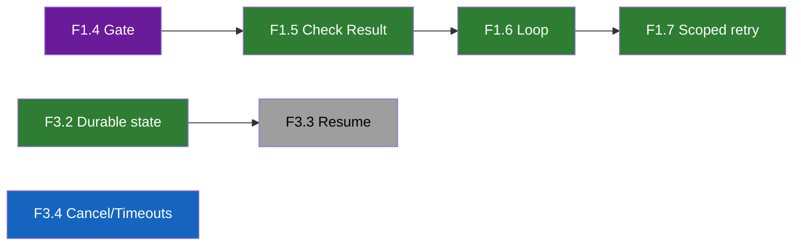

# Propozycja: automatyczne śledzenie roadmapy i wizualizacja

**Status:** propozycja (do decyzji właściciela). Nic z tego nie jest jeszcze wdrożone.
**Powiązane:** `docs/roadmap/audit/AUDIT-2026-11-25.md`, REL2 (`docs/features/REL2-public-roadmap-status.md`), ADR-0031.

## 1. Zasada: najpierw deterministyczny check, potem ocena modelu

To ta sama zasada, którą projekt stosuje do agentów (AGENTS.md, pkt 5 „Deterministic evidence before model judgment”). Proponowany podział ról:

| Warstwa | Co robi | Kiedy | Blokuje? |
|---|---|---|---|
| **`roadmap-check`** (skrypt Go, bez LLM) | waliduje `features.yaml` i `phases.yaml`, sprawdza `evidence`, wyszukuje osierocone tagi `F*-AC*`, regeneruje `STATUS.md` | lokalnie (`make roadmap`), w każdym PR w CI | **tak**, przy błędach; ostrzeżenia nie blokują |
| **Re-audit** (sesja Claude Code w trybie scheduled task) | porównuje repo z `features.yaml` i `canonical-spec.md`, szuka nowych rozjazdów, aktualizuje statusy kryteriów, pisze `audit/AUDIT-<data>.md` z diffem względem poprzedniego audytu | cyklicznie, np. raz w tygodniu | **nie**: otwiera PR do przeglądu przez człowieka |
| **Wizualizacja** | renderuje postęp z `features.yaml`, a nie z tekstu | przy każdym merge do `main` | nie |

Scheduled task nigdy nie zmienia statusu bez PR. Raport modelu jest sugestią. Źródłem prawdy pozostają `features.yaml` i dowody z testów.

## 2. Scheduled task w Claude Code (claude.ai/code)

### 2.1 Konfiguracja

- **Typ:** zadanie cykliczne, każde uruchomienie w świeżej sesji, w środowisku z repo `neuvelia/agent-plane`. Świeża sesja jest celowa: każdy audyt startuje bez kontekstu poprzedniego i opiera się wyłącznie na plikach w repo.
- **Harmonogram:** raz w tygodniu, np. w poniedziałek rano czasu lokalnego (`CRON_TZ=Europe/Warsaw 41 6 * * 1`). Częściej nie ma sensu, bo statusy zmieniają się z PR-ami, a te sprawdza CI.
- **Powiadomienia:** push po zakończeniu. E-mail tylko na życzenie.
- **Uprawnienia:** sesja pushuje wyłącznie na gałąź `roadmap/audit-<data>` i otwiera PR. Nie merguje.
- **Utworzenie:** z sesji Claude Code, prosząc o „utworzenie scheduled task”, albo w UI claude.ai/code. Mogę to zrobić na Twoją prośbę po zatwierdzeniu harnessu.

### 2.2 Prompt zadania (szkic)

```text
Jesteś audytorem roadmapy repo agent-plane. Przeczytaj AGENTS.md (sekcja
"Roadmap discipline"), docs/roadmap/README.md (procedura re-audit),
docs/roadmap/canonical-spec.md i docs/roadmap/features.yaml.

1. Uruchom `make roadmap-check` i zapisz wynik (błędy/ostrzeżenia).
2. Dla każdego feature'a ze statusem innym niż done/deferred oraz dla
   feature'ów zmienionych od daty ostatniego audytu (git log --since):
   sprawdź kryteria akceptacji wobec kodu i testów; aktualizuj status
   kryterium tylko z dowodem (ścieżka testu + nazwa).
3. Sprawdź canonical-spec.md wobec kodu (nazwy stanów, katalog eventów,
   format graphu, interfejs adaptera) i zgłoś rozjazdy.
4. Napisz docs/roadmap/audit/AUDIT-<YYYY-MM-DD>.md z sekcją
   "Zmiany od poprzedniego audytu" (poprawiło się / nowe rozjazdy /
   bez zmian) oraz listą needs_decision.
5. Zregeneruj STATUS.md (`make roadmap`), utwórz gałąź
   roadmap/audit-<data>, commit, push i otwórz PR "[roadmap] audit <data>".
   Nie merguj. Nie zmieniaj kodu produktu ani speców poza features.yaml,
   STATUS.md i plikiem audytu.
Jeśli `roadmap-check` failuje na main, opisz to na górze PR.
```

### 2.3 Koszt i ryzyka

- Jedna sesja tygodniowo. Pełny audyt kodu jest drogi, więc prompt ogranicza go do feature'ów zmienionych od ostatniego audytu i niedomkniętych.
- Model może się mylić. Dlatego wynik zawsze przechodzi przez PR, a `roadmap-check` w CI odrzuci `done` bez dowodów.
- Scheduled task nie zastępuje CI. **Obecnie joby CI nie startują** (audyt, ryzyko 2). Bez działającego CI deterministyczna bramka istnieje tylko lokalnie.

## 3. Wizualizacja: opcje

Wszystkie opcje czytają `features.yaml` (lub wygenerowany z niego JSON). Żadna nie parsuje Markdown.

| Opcja | Co widać | Koszt wdrożenia | Plusy | Minusy |
|---|---|---|---|---|
| **A. `STATUS.md` z diagramami Mermaid** (rekomendowane na start) | tabele postępu P0/P1/P2 per faza, `pie` statusów, `flowchart` zależności feature'ów kolorowany statusem, demo milestones | mały: generator w `roadmap-check` | renderuje się natywnie na GitHubie, zero infrastruktury, wersjonowane w Git, widoczne w diffie PR | statyczne, bez filtrów |
| **B. GitHub Projects (v2)** | tablica i widok roadmapy, każdy feature jako issue z polami Phase/Priority/Status | średni: skrypt synchronizujący `features.yaml` → issues i pola projektu (GitHub Action z tokenem o wąskim zakresie) | filtrowanie, widok Roadmap/Board, linki do PR, przypisania | drugi zapis stanu, więc synchronizacja musi być jednokierunkowa (YAML → Projects); wymaga uprawnień do projektu |
| **C. Strona statyczna (GitHub Pages) z `roadmap.json`** | interaktywny dashboard: fazy, AC, dowody, rozjazdy | średni: generator JSON + prosta strona HTML | pełna kontrola wyglądu; ten sam JSON może zasilić landing (REL2) | kolejny build i deploy; publiczne, chyba że repo i Pages są prywatne |
| **D. Artifact w claude.ai** | prywatny dashboard, który scheduled task odświeża przy każdym audycie | mały | ładny, prywatny, łatwo udostępnić zespołowi | poza repo; zależny od Claude; nie jest źródłem prawdy |

**Rekomendacja:**

1. Start z **A**: od razu w harnessie, bez zależności.
2. Następnie **C** jako realizacja REL2: jeden generator `features.yaml` → `docs/roadmap.json`, z którego korzystają `STATUS.md`, strona i landing. Usuwa to podwójne źródło statusu opisane w audycie (Q3).
3. **B** tylko wtedy, gdy zespół i tak planuje pracę w GitHub Issues.

### 3.1 Przykład diagramu w `STATUS.md` (opcja A)



Kolory i statusy na diagramie mają charakter ilustracyjny. Generator brałby je z rejestru.

## 4. Kolejność wdrożenia

1. Decyzje Q1–Q11 z audytu, w tym rozstrzygnięcie relacji z REL2 (Q3).
2. Faza 2 harnessu: `features.yaml`, `phases.yaml`, `canonical-spec.md`, `roadmap-check`, `STATUS.md` z Mermaid (opcja A), sekcja „Roadmap discipline” w AGENTS.md.
3. `roadmap-check` w `scripts/check.sh` lub jako osobny job CI. Po przywróceniu działania CI.
4. Scheduled task z sekcji 2, uruchomiony najpierw ręcznie raz, potem cyklicznie.
5. Opcjonalnie: C (Pages / REL2), B (Projects), D (artifact).
